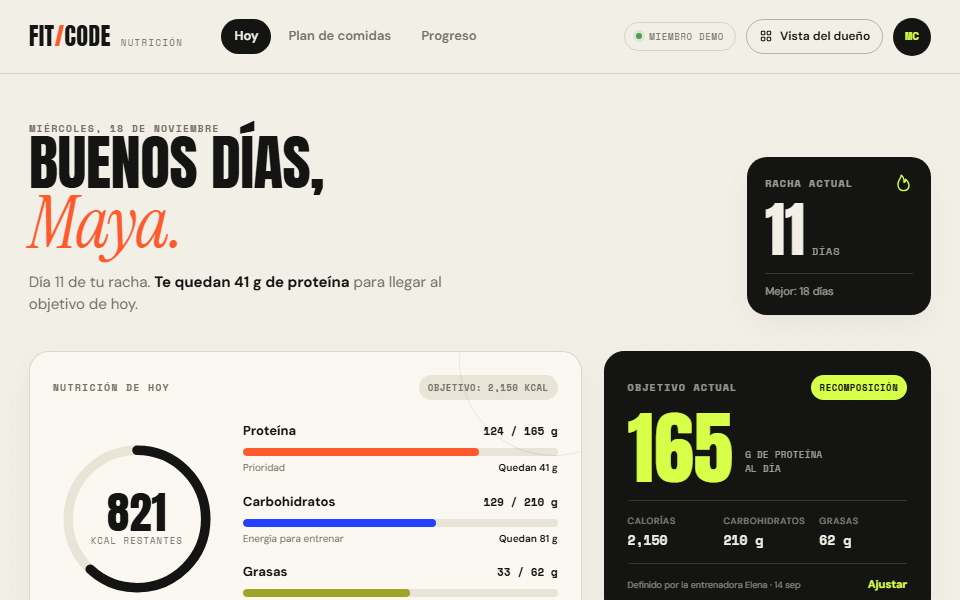

# Fit Code

**A member nutrition app: macro targets, quick food logging, and an AI meal plan with a server-side key.**

[Live demo](https://macro-track-022114835853075413231.vercel.app) | HTML, CSS and JavaScript plus one serverless function



A Spanish-first member app for a nutrition coaching business. The member sees today's targets, logs
food by grams, ounces or hand portions, and can ask for a meal plan that matches their remaining
macros. The owner view covers the account, exports and deletion.

The interface, seed data and error copy are in Spanish because the product is. This README is in
English so another developer can pick the repository up.

## What it does

- **Today**, opened as a seeded, signed-in member: calories and macro rings, streak, planned meals
  and the day's log.
- **Quick add.** Search a food, choose grams, ounces or hand portions, pick a meal, and the rings,
  macro bars and meal list update together.
- **AI meal plan** through one serverless function. The Anthropic key stays server-side, and if the
  call fails the endpoint falls back to a deterministic demo plan rather than an error screen.
- **Owner view** with the member record, plus export and deletion flows.
- **A daily log and history**, persisted in the browser for the demo.
- **Installable PWA metadata** so the app can sit on a phone home screen.

## Run it locally

```bash
node dev-server.mjs
```

Open <http://127.0.0.1:4173>. You can also use `npm run dev`, which starts the same server.

The meal-plan endpoint needs no key locally: without one it returns the deterministic demo plan.

## Verify

```bash
node verify.mjs
# or
npm run check
```

Checks the files, the PWA manifest, the static routes, the AI endpoint, the plan shape and the
per-member daily limit. It starts its own server on an ephemeral port.

## How it is built

| Path | Purpose |
|---|---|
| `index.html` | The member app shell |
| `app.js` | Views, logging, plan request, owner view |
| `data.js` | Seeded member, foods and Spanish copy |
| `styles.css` | The visual system |
| `api/meal-plan.mjs` | Vercel function: key handling, prompt, fallback plan |
| `manifest.webmanifest`, `sw.js` | Installable PWA |
| `verify.mjs` | Verification |

## What is simulated

The member, the food database and the logs are seeded sample data, and the browser holds the state.
The AI call is real when a key is present and a deterministic plan when it is not. The usage limit is
per warm function instance, not a durable quota.

## About this prototype

Built as a working prototype for a real brief, then published as part of a portfolio. The design
point is the server-only key: the browser never holds the provider credential, and the app still
demonstrates the meal-plan flow without one.
